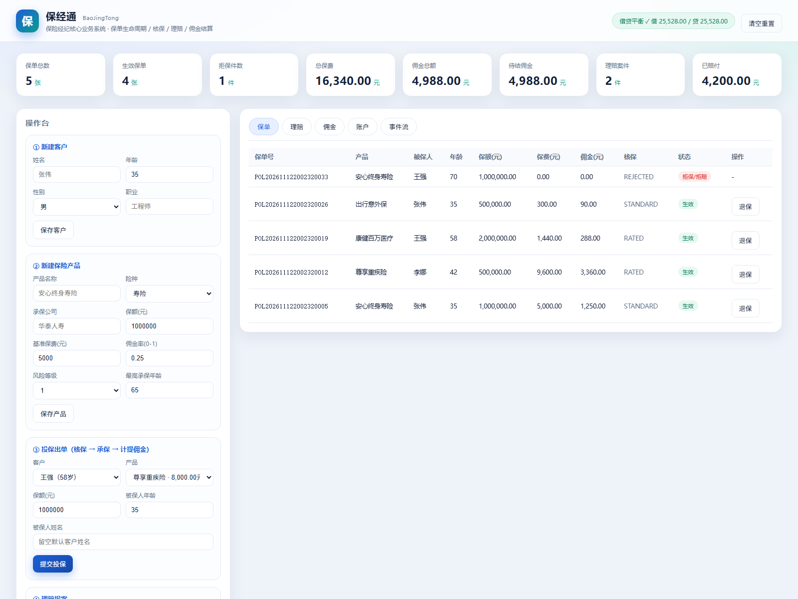
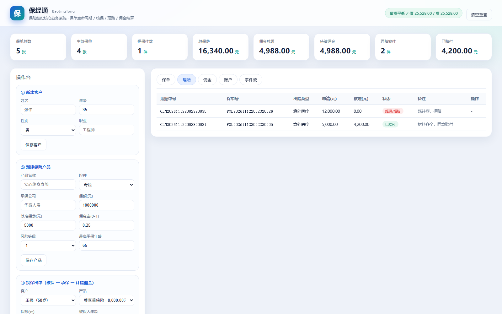
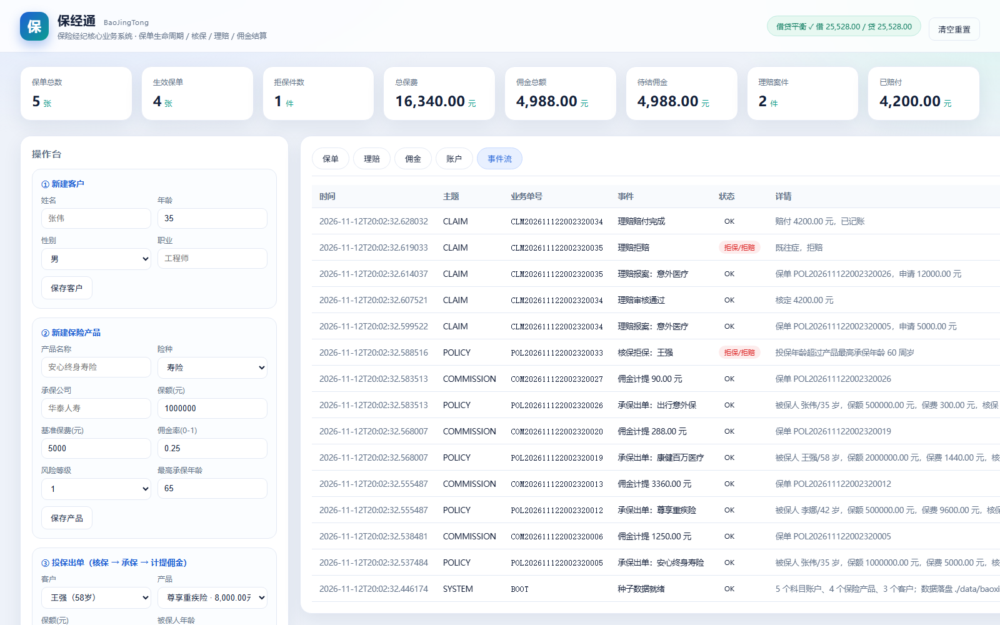

# 保经通 BaoJingTong · 保险经纪核心业务系统

面向保险经纪/代理机构的 ToB 核心业务系统，覆盖**产品配置 → 投保出单 → 核保 → 承保 → 理赔 → 佣金计提与结算**全链路。所有操作都能在网页上手动完成，数据真实落到数据库，页面实时显示每一笔变动。

- 主控制台：<http://localhost:8091>
- H2 数据库控制台：<http://localhost:8091/h2-console>
- Swagger API 文档：<http://localhost:8091/swagger-ui.html>

> 技术规格与设计取舍见 [`SPEC.md`](./SPEC.md)。

---

## 界面预览

控制台总览：KPI、核保结论（标准 / 加费 / 拒保）、保单生命周期与借贷平衡校验。



理赔审核与赔付：报案 → 审核通过 / 拒赔 → 赔付记账。



实时事件流：每一步业务动作留痕，可追溯到具体保单与金额。



---

## 一、环境要求

| 项 | 本机情况 |
|---|---|
| JDK 17 | 已安装（Spring Boot 3.2.5 要求 17+） |
| Maven | 不在 PATH 时，`start.cmd` 会自动回退到 IDEA 自带 Maven |
| 数据库 | 无需安装，使用 H2 文件库 `./data/baoxian.mv.db` |

---

## 二、怎么启动

### 方式 A：一键启动（推荐）

在项目根目录 `c:\Users\xiezhenyu\CodeBuddy\baoxian` 下：

```
start.cmd
```

双击或在命令行执行都可以。脚本会：

1. 自动探测 `mvn`，找不到就回退到 IDEA 自带 Maven；
2. 执行 `clean package -DskipTests`（首次会下载依赖，之后走本地缓存）；
3. 运行 `bootstrap\target\baoxian.jar`。

看到 `Started BaoXianApplication` 后打开 <http://localhost:8091>。
**停止**：在运行窗口按 `Ctrl+C`，或关闭该窗口。

### 方式 B：手动构建启动

```
call "C:\Program Files\JetBrains\IntelliJ IDEA 2026.2.1\plugins\maven-plugin\lib\maven3\bin\mvn.cmd" clean package -DskipTests
java -jar bootstrap\target\baoxian.jar
```

---

## 三、页面怎么用（5 分钟走一遍）

页面左侧是操作台，右侧是数据面板，顶部是 KPI 与「借贷平衡」徽章。

### ① 新建客户

姓名「张伟」、年龄 35、职业「工程师」，点 **保存客户**。也可以直接用预置的 3 个客户。

### ② 新建保险产品

填产品名、险种、承保公司、保额(元)、基准保费(元)、佣金率（0~1）、风险等级，点 **保存产品**。也可以直接用预置的 4 个产品。

### ③ 投保出单

选择客户和产品，填保额与被保人年龄，点 **提交投保**。系统会：

- 按核保规则判定：标准承保 / 加费 20% / 拒保；
- 通过则生成保单（状态「生效」），自动计提佣金；
- 同时生成保费与佣金两组记账分录。

**试一试核保规则**：

| 操作 | 预期 |
|---|---|
| 年龄填 70 投保 | 拒保（超过产品最高承保年龄） |
| 选「尊享重疾险」（风险等级 4） | 加费承保，保费 = 基准保费 × 1.2 |
| 保额填 5000000 投「出行意外保」（上限 50 万） | 拒保（超保额） |
| 年龄 35 投「安心终身寿险」 | 标准体承保 |

### ④ 理赔报案

保单号会自动填上（也可手动填），选出险类型、填申请金额，点 **提交报案**。

### ⑤ 理赔审核与赔付

填理赔单号，选择「审核通过」并填核定金额，点 **提交审核**；再到下方输入理赔单号点 **赔付**。
赔付会实时记账：借 赔付支出 / 贷 银行存款。

### ⑥ 佣金结算

点 **结算全部佣金**，把所有「待结算」佣金记账支付：借 应付佣金 / 贷 银行存款。

### 看效果

- 顶部 KPI 的保费、佣金、已赔付会实时变化；
- 右上角「借贷平衡 ✓」显示借方 = 贷方合计；
- 切到「账户」面板看 5 个科目余额；
- 切到「事件流」看每一步操作的时间线留痕。

**想证明数据真实落库**：打开 <http://localhost:8091/h2-console>，连接参数：

| 字段 | 值 |
|---|---|
| JDBC URL | `jdbc:h2:file:./data/baoxian;MODE=MySQL;DATABASE_TO_LOWER=TRUE;AUTO_SERVER=TRUE` |
| User Name | `sa` |
| Password | 留空 |

```sql
SELECT * FROM policy ORDER BY id DESC;
SELECT * FROM commission_record ORDER BY id DESC;
SELECT * FROM account;
SELECT * FROM account_entry ORDER BY id DESC;
```

---

## 四、自检脚本

服务启动后，在项目根目录执行：

```
powershell -ExecutionPolicy Bypass -File smoke-test.ps1
```

脚本会先重置数据，再跑完整链路（出单 → 幂等 → 报案 → 审核 → 赔付 → 佣金结算 → 借贷平衡），当前 10 项断言全部通过。

---

## 五、数据说明

- 业务数据落盘在 `./data/baoxian.mv.db`，重启不丢失。
- 页面右上角 **清空重置** 会清空业务数据并重新播种（5 个科目账户、4 个保险产品、3 个客户）。
- 也可停止服务后删除 `data` 目录，再次启动自动重建。

---

## 六、项目结构

```
baoxian/
├── start.cmd                     一键构建 + 启动
├── smoke-test.ps1                端到端自检（10 项）
├── SPEC.md                       技术规格说明书
├── README.md                     本手册
├── common/                       统一响应、金额工具、单号、异常
├── domain/                       核保规则、佣金计算、记账规则（零框架依赖）
├── infrastructure/               8 张表实体 + MyBatis-Plus Mapper
├── application/                  出单核保、理赔、佣金结算、记账、看板
├── interfaces/                   REST API + Thymeleaf 控制台
└── bootstrap/                    启动类、配置、schema.sql、种子初始化
```

---

## 七、REST API 一览

统一响应 `{ "code": 0, "message": "ok", "data": ... }`。

```
GET    /api/customers              客户列表（?keyword=）
POST   /api/customers              新建客户
DELETE /api/customers/{id}         删除客户

GET    /api/products               产品列表
POST   /api/products               新建产品
DELETE /api/products/{id}          删除产品

GET    /api/policies               保单列表
POST   /api/policies/apply         投保出单（核保 + 承保 + 佣金 + 记账）
POST   /api/policies/{no}/surrender 退保

GET    /api/claims                 理赔列表
POST   /api/claims                 理赔报案
POST   /api/claims/{no}/review     理赔审核
POST   /api/claims/{no}/pay        理赔赔付（记账）

GET    /api/commissions            佣金列表
POST   /api/commissions/settle     结算全部佣金
POST   /api/commissions/settle/{no} 按保单结算

GET    /api/dashboard              看板汇总 + 借贷平衡
GET    /api/events?limit=          事件流
POST   /api/reset                  清空重置
```

---

## 八、常见问题

| 现象 | 处理 |
|---|---|
| 端口 8091 被占 | 改 `bootstrap/src/main/resources/application.yml` 的 `server.port` |
| `start.cmd` 闪退 | 在 cmd 里手动运行看报错；脚本失败会 `pause` |
| 提示找不到 Maven | 编辑 `start.cmd` 里的 `MVN_CMD` 指向本机 `mvn.cmd` |
| H2 控制台连不上 | JDBC URL 必须与 `application.yml` 完全一致 |
| 页面数据没更新 | 页面 3 秒轮询一次；也可 F5 强制刷新 |
| 想从头演示 | 页面「清空重置」，或删除 `data` 目录 |

---

## 九、面试怎么讲

主线是「**保险的钱和状态，比普通订单复杂在哪**」：

1. **业务复杂度**：保单要经历投保、核保、承保、批改、续期、理赔、退保，每一步都改变资金或责任状态；
2. **核保规则**：规则独立成引擎，可配置、可解释、可审计，而不是散落的 if-else；
3. **资金一致性**：佣金「计提」和「结算」是两笔钱、两个时点，用复式记账保证计提有据、结算可查、借贷平衡；
4. **幂等与状态机**：重复投保靠唯一索引兜底，理赔靠状态单向流转拦截；
5. **架构权衡**：这个阶段刻意不上工作流、MQ、微服务，一致性优先于技术堆叠；
6. **现场演示**：从投保到佣金结算走一遍，再到 H2 控制台查 `account_entry`，证明数据真实落库。

更多设计细节见 [`SPEC.md`](./SPEC.md) §2、§4、§12。
